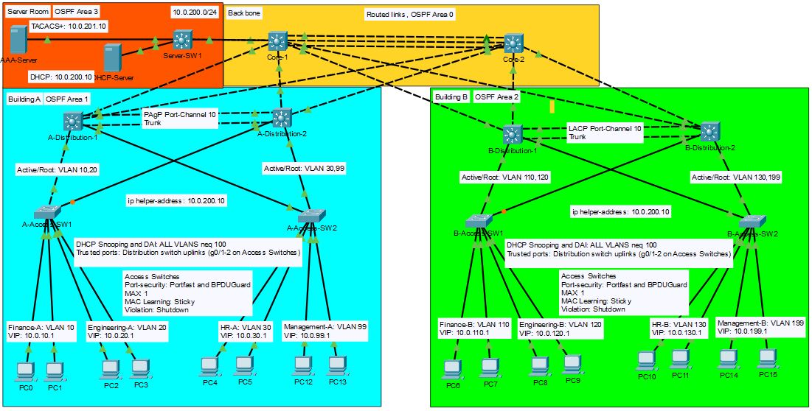

## TNARC Financial: Enterprise Network

The complete network for TNARC Financial (Totally Not A Real Company), built in Cisco Packet Tracer 8.2.2 one lab at a time. Each stage adds a capability, each lab explains that stage in depth.

## Current capabilities
- Redundant three-tier HQ campus: two building and a server room joined by a routed core.
- HSRP gateways and Rapid PVST+, with STP root aligned to HSRP active per VLAN.
- Multi-area OSPF (one area per building) and a central DHCP via relay.
- Access layer security baseline: DHCP snooping, Dynamic ARP inspection, port security and PortFast with BPDU guard on user ports.
- Secured device management: SSH v2 only, central TACACS+ authentication with a local fallback, management access limited to VLAN 99/199, idle timeouts, hashed passwords and login banners.
- Central Syslog with sequence numbers and millisecond timestamps 
- Centralized NTP with timezone set to CST (UTC-6)
- TFTP config backups with a tested restore
- Internal DNS handed out to all clients through DHCP

## Build stages
| Stage | Lab | What it added | Tag |
|-------|-----|---------------|-----|
| 1 | [Lab 01: Three-Tier Campus](https://github.com/gusRod36/TNARC_HQ_Lab_01) | Campus, HRSP, OSPF, Central DHCP | v1-campus |
| 2 | [Lab 02: Access-Layer Security](https://github.com/gusRod36/TNARC_Access_Hardening) | SSH and AAA, DHCP Snooping, DAI, Port-security, BPDU Guard  | v2-accessHardening |
| 3 | [Lab 03: Network Management and DNS](https://github.com/gusRod36/TNARC_Network-Management_Lab03) | DNS, Syslog, TFTP, NTP | v3-network_management | 
| 4 | [Lab 04: Internet Edge and Firewall](https://github.com/gusRod36/Internet_Edge_and_Firewall_Lab04) | In progress... | v4-internetEdge_firewall |

## Design
- [Design Doc](./docs/Design.md)
- [Network Addresses](./docs/Network_Addresses.md)

## Limitations
1. "login block-for" isn't supported in Cisco Packet Tracer, repeated login attempts are slowed but not locked out.
2. Local emergency account is shared.
3. No central logging or time sync yet, so AAA and security events stay on each device.
4. SNMP monitoring isn't demonstrable in Packet Tracer; production would use SNMPv3 (authPriv), read-only views and an ACL limited to the monitoring server.
5. Syslog (UDP) and TFTP are unencrypted, and TFTP is unauthenticated, production would use TLS syslog and SCP/SFTP for backups.
6. Backups are run by hand, production would schedule them automatically.
7. Syslog, TFTP and DNS share one server, a single point of failure
8. NetFlow is deferred until there's a router at the internet edge. 

*Built by Gustavo Rodriguez - [LinkedIn](https://www.linkedin.com/in/gustavo-rodriguez-200aab423/)*