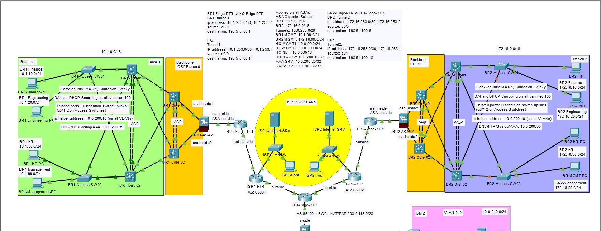
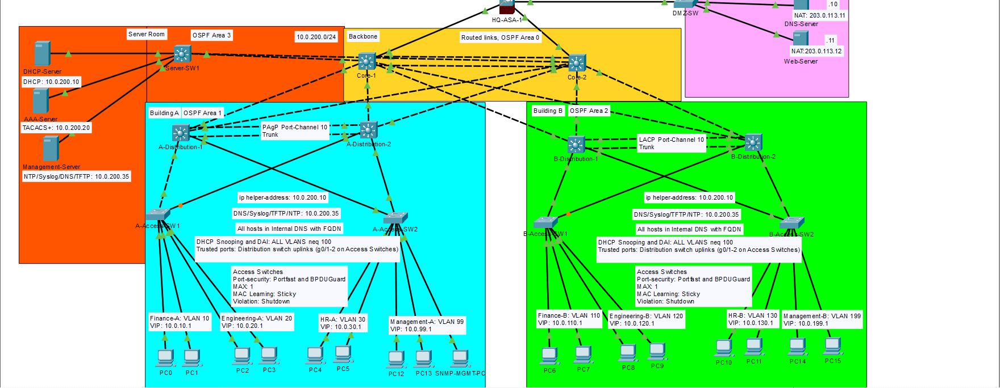

## TNARC Financial: Enterprise Network

The complete network for TNARC Financial (Totally Not A Real Company), built in Cisco Packet Tracer 8.2.2 one lab at a time. Each stage adds a capability, each lab explains that stage in depth.

## Current capabilities
- Redundant three-tier HQ campus: two building and a server room joined by a routed core.
- HSRP gateways and Rapid PVST+, with STP root aligned to HSRP active per VLAN.
- Multi-area OSPF (one area per building) and a central DHCP via relay.
- Access layer security baseline: DHCP snooping, Dynamic ARP inspection, port security and PortFast with BPDU guard on user ports.
- Secured device management: SSH v2 only, central TACACS+ authentication with a local fallback, management access limited to VLAN 99/199, idle timeouts, hashed passwords and login banners.
- Central Syslog with sequence numbers and millisecond timestamps 
- Centralized NTP with timezone set to CST (UTC-6)
- TFTP config backups with a tested restore
- Internal DNS handed out to all clients through DHCP
- Internet edge: dual ISPs over eBGP with TNARC's own public block, PAT and static NAT, and automatic failover on ISPs.
- Perimeter firewall, ASA with inside, DMZ, and outside zones, deny by default rules with logging and a DMZ hosting public web and DNS.
- Site-to-site VPN: each branch joins HQ through an encrypted GRE over IPsec tunnel. (IKEv1, AES-256, Unique keys per branch)
- Multi-protocol routing: OSPF at branch 1 and EIGRP at branch 2 redistributed at a single point on HQ-Edge-RTR.
- Direct internet access at each branch through their own ISP, traffic is translated to TNARC's own /28 addresses. Company traffic always uses tunnels.
- Fail closed set up so if a tunnel drops all company traffic is denied at the ISP interface instead of leaving unencrypted.
- Firewall at each branch, HQ ASA traffic gets only the services needed (DHCP, DNS, AAA, syslog, NTPm TFTP, SSH from management).
- Centralized services: All branch devices get DHCP, AAA, syslog and NTP from HQ and meet the security baselines previously established.

## Build stages
| Stage | Lab | What it added | Tag |
|-------|-----|---------------|-----|
| 1 | [Lab 01: Three-Tier Campus](https://github.com/gusRod36/TNARC_HQ_Lab_01) | Campus, HRSP, OSPF, Central DHCP | v1-campus |
| 2 | [Lab 02: Access-Layer Security](https://github.com/gusRod36/TNARC_Access_Hardening) | SSH and AAA, DHCP Snooping, DAI, Port-security, BPDU Guard  | v2-accessHardening |
| 3 | [Lab 03: Network Management and DNS](https://github.com/gusRod36/TNARC_Network-Management_Lab03) | DNS, Syslog, TFTP, NTP | v3-network_management | 
| 4 | [Lab 04: Internet Edge and Firewall](https://github.com/gusRod36/Internet_Edge_and_Firewall_Lab04) | Dual-ISP eBGP, NAT/PAT, ASA Perimeter, DMZ | v4-internet_and_firewall |
| 5 | [Lab 05: Branch Expansion](https://github.com/gusRod36/TNARC_Branch_Expansion_Lab05) | WAN, GRE over IPsec, OSPF/EIGRP redistribution, branch firewalls, direct internet access, centralized services  | v5-branch_expansion | 
| 6 | [Lab 06: Upgrading to SD-WAN and Wi-FI](https://github.com/gusRod36/TNARC_SD-WAN_and_Wi-Fi) | Planned... |

## Design
- [Design Doc](./docs/Design.md)
- [Network Addresses](./docs/Network_Addresses.md)

## Limitations
1. "login block-for" isn't supported in Cisco Packet Tracer, repeated login attempts are slowed but not locked out.
2. Local emergency account is shared.
3. No central logging or time sync yet, so AAA and security events stay on each device.
4. SNMP monitoring isn't demonstrable in Packet Tracer; production would use SNMPv3 (authPriv), read-only views and an ACL limited to the monitoring server.
5. Syslog (UDP) and TFTP are unencrypted, and TFTP is unauthenticated, production would use TLS syslog and SCP/SFTP for backups.
6. Backups are run by hand, production would schedule them automatically.
7. Syslog, TFTP and DNS share one server, a single point of failure
8. NetFlow is deferred until there's a router at the internet edge. 
9. No branch ISP redundancy, the ISP routers ran out of routing ports in CPT. A back tunnel design is documented.
10. Hub and spoke only, branch to branch traffic crosses HQ.

*Built by Gustavo Rodriguez - [LinkedIn](https://www.linkedin.com/in/gustavo-rodriguez-200aab423/)*